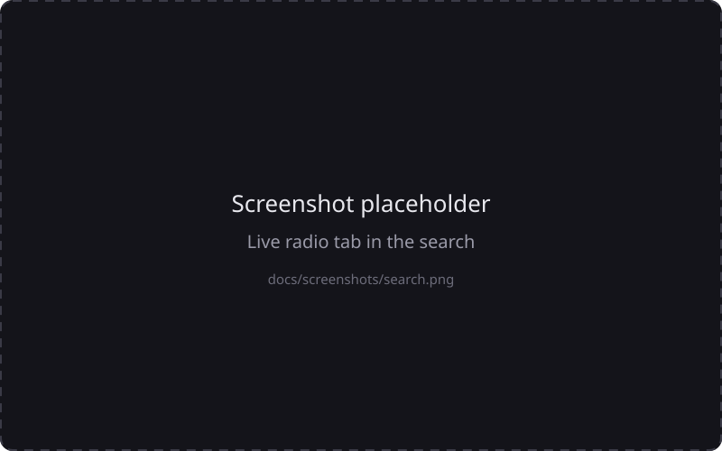
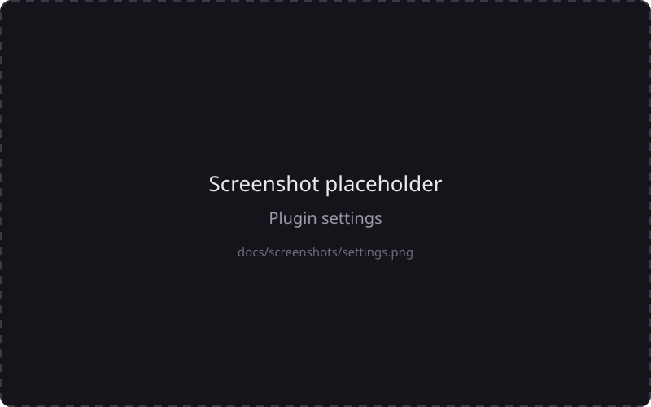

<div align="center">

# NxtSound plugin: Online radio

**Thousands of live radio stations, right inside your own music server.**

[](https://github.com/nxtsound/nxtsound-plugin-onlineradio/actions/workflows/ci.yml)
[](LICENSE)


</div>

A plugin for the [NxtSound server](https://github.com/nxtsound/nxtsound-server). It adds a **Live radio** tab to the search: type a station name,
tap it, and it plays, with the current song shown in the player and on the lock screen when the station tells it.
Stations come from the community database [radio-browser.info](https://www.radio-browser.info). No account, no API key, nothing stored.

<p align="center">
  
</p>

## Features

- 📻 **Live radio tab** next to Songs, Artists and Albums, with a result count; the tab with the most hits is selected for you
- 🔎 **Forgiving search**: ignores upper and lower case and tries other spellings (`srf3` finds `SRF 3`, `sunshine live` finds `sunshinelive`)
- 💬 **Search suggestions** with station names while you type
- 🎶 **Now playing**: shows the song the station plays right now, when the station sends it
- ⏱ **Start buffer** (adjustable) that smooths over short hiccups of a station
- 🌍 **Mirrors**: choose the radio-browser.info server and a fallback in the settings
- ➕ **Add a station** to the public database from inside NxtSound
- In the player, live streams show "Live" instead of a progress bar

## Install

You need a running [NxtSound server](https://github.com/nxtsound/nxtsound-server) and admin rights.

**In the admin area (easiest):** Plugins → enter `https://github.com/nxtsound/nxtsound-plugin-onlineradio` → **Install**. The first time takes a minute while the server sets the plugin up.

**By hand:**

```sh
cd /path/to/nxtsound-server/plugins        # Docker setup: the ./plugins folder next to docker-compose.yml
git clone https://github.com/nxtsound/nxtsound-plugin-onlineradio onlineradio
# then restart the server
```

The folder must be called `onlineradio` (it has to match the plugin's id).

**Update:** when a newer version is on GitHub, the plugin's card shows a green **Update available** button.

## Use

Open the search, type a name, and switch to the **Live radio** tab. Tap a station to play it. Add it to a playlist or like it like any song.
Stations have no end and cannot be seeked.

## Settings

The gear button on the plugin's card (Admin area → Plugins) opens the settings; changes apply at once.

| Setting | Meaning |
|---|---|
| Server mirror | The radio-browser.info server asked first (default `de1`). |
| Fallback mirror | Used when the main mirror does not answer or reports a server error (default `de2`; "None" turns it off). |
| Start buffer | Seconds of audio collected before playback starts (0–30, default 3). A head start bridges short hiccups: fewer dropouts, later start. |

The start buffer only costs time as far as a station is slower than real time. With one big station that sends a fast burst first: 0 s starts after 0.4 s, 3 s after 0.5 s,
10 s after 5.6 s. Stations that send strictly in real time need as many seconds as you set. If playback stutters, raise the value; if it starts too late, lower it.

The sheet also shows which mirror answered last and the last problem, if any.

**Add a station:** the button "Add a station to radio-browser.info" opens a form (name and stream address are required; homepage, logo, country code, languages and tags are optional).
The station is added to the **public** database for everyone, so only add stations that really exist. It can take a while until it shows up in the search.

<p align="center">
  
</p>

## Good to know

- Not every station tells what it plays: some send nothing, some only their slogan or the name of the show, and some write "Title - Artist" instead of "Artist - Title"
  (the text is shown as sent; only the lock screen's artist and title fields are swapped then). Stations that answer with the old `ICY 200 OK` instead of HTTP cannot be read at all.
- HLS streams (`.m3u8`) are not supported and are left out of the results.
- The plugin only talks to radio-browser.info and to the stations you play.

## How it works

| Request from the server | What the plugin does |
|---|---|
| `GET /search?kind=radio` | asks radio-browser.info for stations by name, most popular first (no bitrate filter: big stations often report 0); also tries other spellings; merges the answers without duplicates |
| `GET /suggest` | station names matching what is typed |
| `GET /nowplaying/{id}` | reads the first ICY metadata block of the stream with a short extra connection; cached for 15 s per station |
| `GET /stream/{id}` | looks the station up by its ID, opens its stream and passes the bytes on (live: no end, no seeking) |

## Development

```sh
python3 -m venv .venv && .venv/bin/pip install -r requirements-dev.txt "uvicorn[standard]"
PLUGIN_TOKEN=secret .venv/bin/uvicorn app:app --port 8100
python /path/to/nxtsound-server/plugincheck.py http://localhost:8100 --token secret --query swr3
.venv/bin/python -m pytest -q          # no network needed: radio-browser.info and the stations are simulated
```

Name, description and version live in `plugin.json` only. The protocol is described in the server's [plugin guide](https://github.com/nxtsound/nxtsound-server/blob/main/PLUGINS.md).
`tests/vendor/` holds a copy of the server's protocol check (`pluginproto.py`, `plugincheck.py`); after a protocol change, copy them again and in `plugincheck.py` change `import pluginproto` to `from . import pluginproto`.

**Add a mirror:** radio-browser.info runs several servers (list: <https://all.api.radio-browser.info/json/servers>). Add one line to the `MIRRORS` list at the top of `app.py`,
`("host.api.radio-browser.info", "Label in the settings")`. Both settings offer it automatically.

## Status and roadmap

**Alpha.** It works and has tests, but the plugin system it runs on is young.
Ideas: favorite stations, browsing by country or tag, HLS support. Pull requests are welcome, see [CONTRIBUTING.md](CONTRIBUTING.md).

## Support

This plugin is part of the NxtSound project; ways to support it are on the [server's page](https://github.com/nxtsound/nxtsound-server#support-the-project).
Bugs and ideas: [open an issue](https://github.com/nxtsound/nxtsound-plugin-onlineradio/issues).

## License

MIT, see [LICENSE](LICENSE). The station data belongs to radio-browser.info and the stations' operators.
